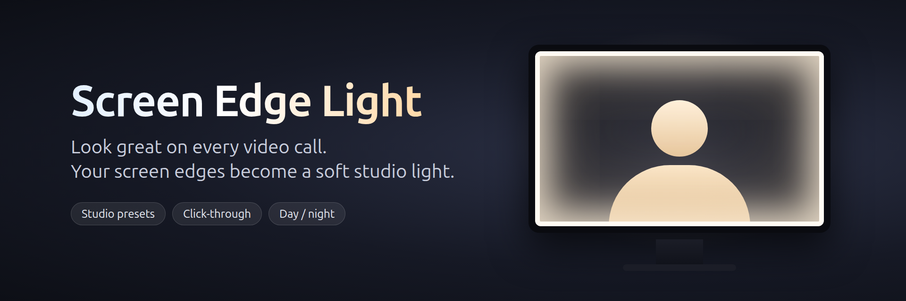

# Screen Edge Light

**Look great on every video call.** Screen Edge Light turns the edges of your monitor into a soft, adjustable ring light for Zoom, Google Meet, Teams, Discord, OBS and streaming. No extra hardware needed.



[](https://snapcraft.io/screen-edge-light)

```bash
sudo snap install screen-edge-light
```

## Features

- **Studio presets**: Soft Key, Warm Studio, Daylight, Cool and Candle, one click each
- **Studio Flood**: a wide, soft glow that actually lights your face, or a classic thin glowing border
- **Spotlight**: instant full-brightness boost; click again to go back to your settings
- **Color temperature**: from crisp cool daylight to warm candlelight
- **Fine-tuning**: brightness, light spread, border thickness, distance from the edge, corner roundness
- **Auto day / night**: warmer and dimmer in the evening, bright and neutral at midday
- **Match screen colors**: tints the light to what's on screen (X11 sessions only)
- **Click-through overlay**: the light never blocks your mouse, so you keep working normally
- **Start on login**
- Settings are remembered between sessions

## Using it

- The control panel opens when the app starts. Close it with **✕**, and bring it back with the round **⚙** button in the bottom-right corner, or by launching the app again.
- **Keyboard shortcut to turn the light on/off:** open *Settings → Keyboard → View and Customize Shortcuts → Custom Shortcuts*, add a shortcut with the command `screen-edge-light --toggle`, and pick any key combination.
- **Quit** from the button at the bottom of the control panel.

## Building from source

Requires the .NET 10 SDK (`sudo apt install dotnet-sdk-10.0` on Ubuntu 24.04).

```bash
dotnet run --project UbuntuEdgeLight.Linux/UbuntuEdgeLight.Linux.csproj
```

To build the snap: `snapcraft pack`. The release process is described in [PUBLISHING.md](PUBLISHING.md).

Built with [Avalonia](https://avaloniaui.net/).

## Credits

Inspired by and originally based on [Windows Edge Light](https://github.com/shanselman/WindowsEdgeLight) by Scott Hanselman.

## License

MIT
